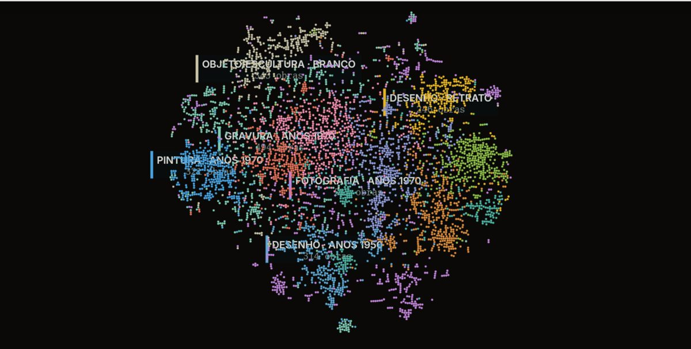
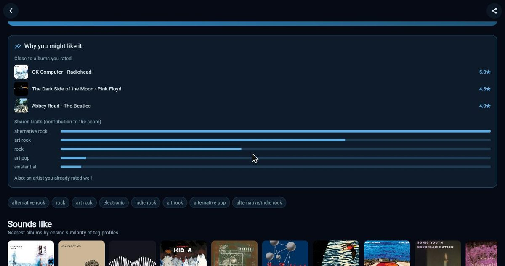

## Daniel Martins

Pesquiso no ICMC-USP. Trabalho com **visão computacional e aprendizado de
máquina aplicados a acervos e imagens**: modelos que reconhecem, classificam e
encontram coisas em material que já existe — obras de museu, filmes de arquivo,
espectros de laboratório, discos. Gosto de entregar isso como ferramenta que
alguém de fora da computação consegue usar.

---

### decupagem — visão computacional para a sala de montagem
[demo](https://danmartsarr.github.io/decupagem/) · [código](https://github.com/danmartsarr/decupagem)

Recebe um filme bruto e devolve a folha de decupagem: cada plano com timecode,
escala (detalhe, primeiro plano, médio, geral, cartela), o que é dito nele e uma
miniatura. Busca planos por descrição, acha planos parecidos e exporta **EDL**
para o DaVinci Resolve ou o Premiere. Um **servidor MCP** deixa um assistente
fazer a pesquisa no material conversando.
CLIP + classificador treinado (0,91 de acurácia contra 0,51 do zero-shot) +
Whisper, demonstrado em filmes de 1935 e 1937 em domínio público.

### Acervo do MAC USP — mapa de semelhança visual
[site](https://danmartsarr.github.io/mac-mockup/relacoes/) · [validação](https://github.com/danmartsarr/validacao-tags-mac)

Protótipo de site para o Museu de Arte Contemporânea da USP em que milhares de
obras se organizam por semelhança visual (vetores do **DINOv3**), com busca por
imagem, paleta de cores e boletins históricos transcritos por OCR. Um segundo
projeto mede, com quatro validadores, a precisão das etiquetas que o modelo
atribuiu a cada obra.

### cadence — recomendação de discos que explica o porquê
[demo](https://danmartsarr.github.io/cadence/) · [código](https://github.com/danmartsarr/cadence)

App em Flutter: você avalia álbuns e recebe recomendações com o motivo de
cada uma. TF-IDF sobre as tags do MusicBrainz, perfil Rocchio, diversificação
MMR e uma avaliação offline (recall@10 de 0,83 contra 0,015 do aleatório).

### RAVI — identificação de microplásticos por infravermelho
[app](https://danmartsarr.github.io/Sistema/) · [código](https://github.com/danmartsarr/Sistema)

Rede neural que identifica o polímero (EVA, PA, PE, PP, PS, celulose) a partir
do espectro FTIR e mostra, por saliência, quais bandas decidiram a resposta.
API em FastAPI e app em Flutter.

### Também
- [Remoção de linhas de pauta em partituras manuscritas](https://github.com/danmartsarr/Projeto_Final_SCC0251) — processamento de imagens clássico, avaliado pixel a pixel na base CVC-MUSCIMA.

---

Python · PyTorch · Hugging Face · scikit-learn · OpenCV · MCP · Flutter · JavaScript
