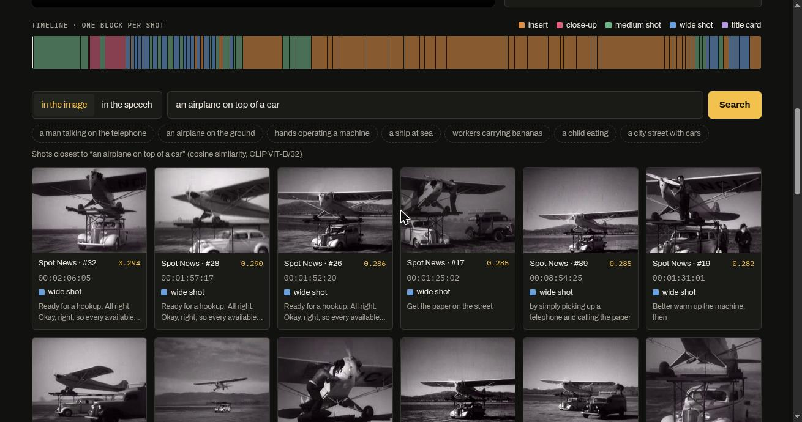

## Daniel Martins

PhD student at ICMC, University of São Paulo. My thesis applies **computer
vision to the collection of the Museum of Contemporary Art (MAC USP)**: how
models can relate, describe and help people explore thousands of artworks.
Outside the thesis I build tools with the same idea — models trained or
adapted for one specific task, delivered as something a non-programmer can use.

---

### PhD research · MAC USP collection

#### Visual similarity map of the collection
[live site](https://danmartsarr.github.io/mac-mockup/relacoes/) · [repo](https://github.com/danmartsarr/mac-mockup)

A prototype museum website where thousands of artworks are laid out by visual
similarity (**DINOv3** embeddings), with search by image, colour palettes and
historical bulletins transcribed with OCR.

Zoomed into the map: drawings of the human figure that DINOv3 placed next to each other.

#### Human validation of model tags
[live site](https://danmartsarr.github.io/validacao-tags-mac/) · [repo](https://github.com/danmartsarr/validacao-tags-mac)

Four reviewers check, artwork by artwork, the tags that DINOv3 (dino.txt)
assigned to the collection, to measure the model's precision before the tags
are used anywhere.

---

### Other projects

#### decupagem — computer vision for the editing room
[demo](https://danmartsarr.github.io/decupagem/) · [repo](https://github.com/danmartsarr/decupagem)

Turns raw footage into a shot log: every shot with timecode, shot scale, what
is said in it and a thumbnail. Search shots by description, find similar
shots and export an **EDL** for DaVinci Resolve or Premiere. An **MCP server**
lets an assistant search the footage in conversation.
CLIP + a trained shot-scale classifier (0.91 accuracy vs 0.51 zero-shot) +
Whisper, demonstrated on public-domain films from 1935 and 1937.

#### Museu Leonilson — digital museum
[live site](https://danmartsarr.github.io/museu-leonilson/)

Website for the work of Brazilian artist José Leonilson: collection by decade,
biography and an interactive canvas. Every image carries the Projeto Leonilson
watermark, burned into the files themselves.

#### cadence — album recommendations that explain themselves
[demo](https://danmartsarr.github.io/cadence/) · [repo](https://github.com/danmartsarr/cadence)

Flutter app: rate albums and get recommendations with the reason for each one.
TF-IDF over MusicBrainz tags, Rocchio user profile, MMR diversification and an
offline evaluation (recall@10 of 0.83 vs 0.015 random).

#### RAVI — microplastic identification from infrared spectra
[app](https://danmartsarr.github.io/Sistema/) · [repo](https://github.com/danmartsarr/Sistema)

Neural network that identifies the polymer (EVA, PA, PE, PP, PS, cellulose)
from an FTIR spectrum and shows, through saliency, which bands drove the
answer. FastAPI backend and Flutter app.

#### Also
- [Staff-line removal in handwritten scores](https://github.com/danmartsarr/Projeto_Final_SCC0251) — classical image processing, evaluated pixel by pixel on CVC-MUSCIMA.

---

Python · PyTorch · Hugging Face · scikit-learn · OpenCV · MCP · Flutter · JavaScript
